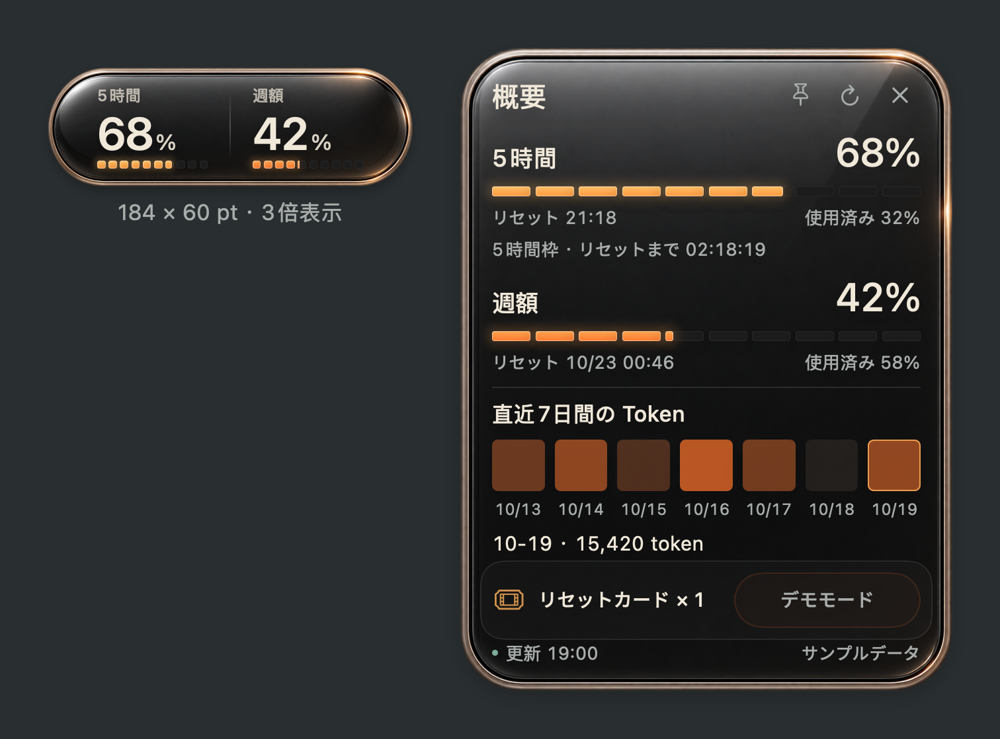

# Usage Capsule

[简体中文](README.zh-CN.md) · [English](README.md) · **日本語** · [한국어](README.ko.md)

Codex の5時間枠と週間上限を確認できる、小さな macOS デスクトップウィジェット。光沢のあるダークガラス、温かみのある金属の縁、5段階のカラー表示。通常の表示サイズは **184 × 60 pt** です。



## 機能

- 5時間枠・週間の残量、リセット時刻、カウントダウン。
- ホバーで概要を表示、クリックで固定、× または Escape で閉じる。
- 直近7日間の Token 消費量を日付ごとのセルで確認。
- 残量に応じた5段階の色。50%付近でも明るさを維持。
- ウィジェット全体からドラッグ可能。メニューバー、100–150%の拡大、最前面表示に対応。
- 簡体字中国語・英語・日本語・韓国語。システム設定への追従、手動切り替え。
- 利用可能なリセットカードの表示。0.8秒長押しすると確認画面が開き、明示的に確認した後でのみ要求を送信します。キャンセルや Escape では消費しません。デモでは使用できません。

## 必要環境とインストール

**Apple Silicon Mac、macOS 13以降、Xcode Command Line Tools** が必要です。実際の利用状況の取得には、ローカルでログイン済みの Codex CLI が必要です。

Codex に次のように依頼できます：

> $skill-installer で https://github.com/guihaoyegui-ctrl/usage-capsule の skills/usage-capsule をインストールし、$usage-capsule で Mac 上にアプリをビルド、インストール、起動してください。

手動で行う場合は、ダウンロードしたリポジトリ内で実行します：

```sh
zsh skills/usage-capsule/scripts/capsule.sh doctor
zsh skills/usage-capsule/scripts/capsule.sh install
zsh skills/usage-capsule/scripts/capsule.sh start
```

アプリはローカルでビルドされ、`~/Applications/Usage Capsule.app` に配置されます。現在はアドホック署名のプレビュー版で、Developer ID による公証はありません。Gatekeeper を無効化せず、ソースを確認してビルドしてください。コンパイラがない場合は `xcode-select --install` を使用します。

右クリックまたはメニューバーから設定・更新・非表示・終了を選択できます。設定で日本語を選ぶか、`zsh skills/usage-capsule/scripts/capsule.sh language ja` を実行してください。

`preview` はサンプル PNG を生成します。`demo` はインストール済みアプリが停止中の場合にデモを開きます。これらはアカウント利用状況を取得しません。Skill のインストールだけではアプリは起動しません。クラウドのみの環境ではデスクトップに表示できません。

## データについて

60秒ごとにローカル Codex app-server のアカウント情報を読み取ります。モデルの生成ターンは作成しません。既存の Codex ログインを使用し、開発者のサーバーや分析サービスには送信しません。詳細は [Privacy](docs/PRIVACY.md) を参照してください。

このアプリはコミュニティプロジェクトであり、OpenAI の公式製品ではありません。日別消費量やリセットカードは CLI とアカウントの対応状況に依存します。不明な値はゼロとして表示しません。[検証範囲](docs/VALIDATION.md)と[トラブルシューティング](docs/TROUBLESHOOTING.md)もご確認ください。

このプレビューには、まだオープンソースライセンスが選択されていません。
