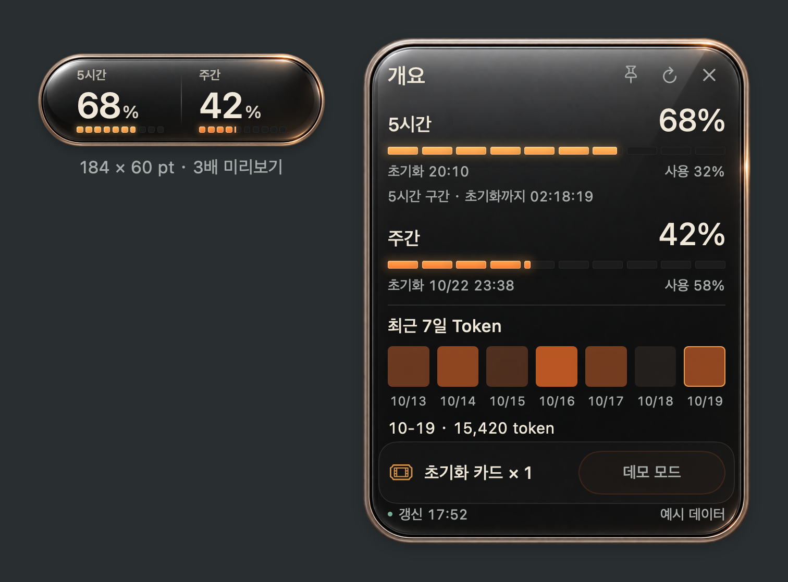

# Usage Capsule

[简体中文](README.zh-CN.md) · [English](README.md) · [日本語](README.ja.md) · **한국어**

Codex의 5시간 및 주간 한도를 확인하는 작은 macOS 데스크톱 위젯입니다. 광택 있는 어두운 유리, 따뜻한 금속 테두리, 다섯 단계 색상을 **184 × 60 pt** 크기로 표시합니다.



## 0.10.1 미리 보기 기능

- 실제 기간으로 5시간·주간 한도를 구분하고 잔여량, 사용률, 초기화 시각과 카운트다운을 표시합니다.
- 개요에 계정이 반환한 멤버십을 표시합니다. Pro 계열에 유한한 5시간 한도가 없으면 **∞**, 주간은 실제 수치를 표시합니다. ∞는 5시간 한도에만 해당하며 실제 유한 한도 응답이 우선합니다.
- Free／Go는 로컬 Codex와 계정이 제공하는 데이터 범위에서 기본 호환됩니다. 알 수 없는 값을 0이나 무제한으로 바꾸지 않습니다.
- 멤버십과 사용량을 **60초마다** 확인하고 수동 새로 고침, 지원되는 계정 알림, 앱 재활성화, Mac 깨우기 시에도 재확인합니다. 즉시 실시간 감지가 아니며 서버 갱신이 지연될 수 있습니다.
- 최근 7일 Token 소비를 셀로 표시하고 마우스를 올리거나 선택해 해당 날짜의 보고 수치를 확인합니다.
- 광택 있는 어두운 유리와 금속 테두리, **184 × 60 pt**, 100–150% 확대, 항상 위에 표시. 잔여량에 따른 다섯 단계 색상과 중간 잔여량에서도 선명한 조명.
- 마우스를 올리면 애니메이션 개요, 클릭 고정, ×／Escape 닫기. 시스템 동작 줄이기 설정 지원.
- 창 전체에서 드래그하고 위치를 저장합니다. 오른쪽 클릭／메뉴 막대에서 찾기, 새로 고침, 설정, 숨기기, 종료.
- 중국어 간체, 영어, 일본어, 한국어 및 시스템 언어 자동 선택.
- **명시적으로 선택한 대화만 자동 재개**하며 기본 선택은 없습니다. 일회 또는 계속 재개를 선택할 수 있으며 허용 이후 확인된 한도 중단만 처리합니다. 즉시 실행하거나 이전 실패를 되살리지 않습니다.
- 승인／작업 선택／기록의 세 탭, 로드된 작업·프로젝트 검색, 추가 로드, 사용 가능한 전체 제목 확인과 우선순위 변경.
- 회복 후 원래 Codex 대기열에 한 번 전달합니다. 해당 실행과 최종 응답의 종료를 확인하거나 사용자가 직접 확인해 허용한 뒤 다음 항목을 전달합니다. 상태가 불명확하면 대기합니다.
- 전체 일시 중지, 개별 승인 취소, 미실행 대기 명령 취소, 5시간·주간 보존값. 보존값은 새 전달을 막으며 실행 중인 작업의 엄격한 사용 상한은 아닙니다.
- 로컬 결과 카드, 원래 대화 링크, 선택적 종료／실패 알림. 응답 발췌에 별도 요약 모델을 호출하지 않습니다. 한 차례 실행 종료가 전체 프로젝트 완료를 뜻하지는 않습니다.
- 인스턴스 간 공유되는 모드별 승인·취소, 계정 연결, 영구 전달 기록과 불확실한 전송의 중복 재시도 방지. 실행 중인 작업 중지와 도구 승인은 원래 Codex에서 처리합니다.
- 초기화 카드는 0.8초 길게 눌러 확인 창을 연 뒤 사용자가 명시적으로 승인해야 전송합니다. 직전 계정과 카드 상태를 다시 확인하며 자동 재개／데모는 카드를 사용하지 않습니다.
- 로그인 만료 시 연결을 한 번 재생성합니다. 인증 실패가 지속되면 이전 한도·멤버십을 지우고 일시적 오류에는 마지막 확인값으로 표시합니다.
- 계정 변경 알림이 오면 이전 전달 판단을 무효화합니다. 자동 재개에는 백엔드의 명시적 사용 허가와 확인 가능한 적용 한도가 필요합니다.

**미리 보기 범위:** 앱이 실행 중이고 Mac이 깨어 있을 때만 확인합니다. API 지원은 Codex 버전과 계정에 따라 다릅니다. Pro／Free／Go는 모의 검증, 실제 Plus 조회 및 대기열／기록 경로는 확인했습니다. Free／Go의 주간 한도만 있는 누락 초기화 추론은 보수적으로 처리합니다. [동작 규칙](docs/AUTO_RESUME.md)·[검증 범위](docs/VALIDATION.md).

## 재개 모드

작업마다 기본값인 “한 번만 재개” 또는 “계속 재개(횟수 제한 없음)”를 선택할 수 있습니다. 계속 모드는 허용 이후 한도 중단을 복구할 때마다 재개하며 언제든 취소하거나 전체 일시 정지할 수 있습니다. 정상 응답 종료, 사용자 입력 대기, 수동 중지 또는 다른 오류 후에는 새 실행을 시작하지 않습니다. 중단별 영구 기록으로 중복을 방지하고 이전 선택이나 소진된 허용을 유효한 체크로 표시하지 않습니다.

## 요구 사항과 설치

**Apple Silicon Mac, macOS 13 이상, Xcode Command Line Tools**가 필요합니다. 실제 사용량을 보려면 로컬 Codex CLI에 로그인되어 있어야 합니다.

Codex에 다음과 같이 요청할 수 있습니다:

> $skill-installer로 https://github.com/guihaoyegui-ctrl/usage-capsule의 skills/usage-capsule을 설치한 다음, $usage-capsule로 내 Mac에서 앱을 빌드하고 설치한 뒤 시작해 주세요.

직접 설치하려면 저장소를 다운로드하고 해당 폴더에서 실행합니다:

```sh
zsh skills/usage-capsule/scripts/capsule.sh doctor
zsh skills/usage-capsule/scripts/capsule.sh install
zsh skills/usage-capsule/scripts/capsule.sh start
```

로컬에서 빌드한 앱은 `~/Applications/Usage Capsule.app`에 설치됩니다. 현재는 임시 서명된 미리보기 버전이며 Developer ID 공증을 받지 않았습니다. Gatekeeper를 끄지 말고 소스를 검토한 후 빌드하세요. 컴파일러가 없으면 `xcode-select --install`을 실행합니다.

위젯을 오른쪽 클릭하거나 메뉴 막대 아이콘에서 설정, 새로고침, 숨기기, 종료를 선택할 수 있습니다. 설정에서 한국어를 선택하거나 `zsh skills/usage-capsule/scripts/capsule.sh language ko`를 실행하세요.

`preview`는 예시 PNG를 생성합니다. `demo`는 설치된 앱이 정지된 상태에서 데모 창을 엽니다. 두 모드 모두 계정 사용량을 조회하지 않습니다. Skill 설치만으로 앱이 시작되지는 않으며, 클라우드 전용 환경에서는 Mac 데스크톱에 창을 표시할 수 없습니다.

## 데이터와 개인정보

60초마다 로컬 Codex app-server에서 계정 사용량 확인 자체는 모델 생성 턴을 만들지 않습니다. 자동 재개가 실행되면 사용 한도가 소모됩니다. 기존 Codex 로그인을 사용하고 개발자 서버나 분석 서비스로 데이터를 보내지 않습니다. 자세한 내용은 [Privacy](docs/PRIVACY.md)를 참고하세요.

이 앱은 커뮤니티 프로젝트이며 OpenAI 공식 제품이 아닙니다. 일별 소비량과 초기화 카드 지원은 CLI와 계정에 따라 달라집니다. 알 수 없는 값은 0으로 처리하지 않습니다. [검증 범위](docs/VALIDATION.md)와 [문제 해결](docs/TROUBLESHOOTING.md)도 확인해 주세요.

현재 미리보기에는 오픈소스 라이선스가 아직 지정되지 않았습니다.
