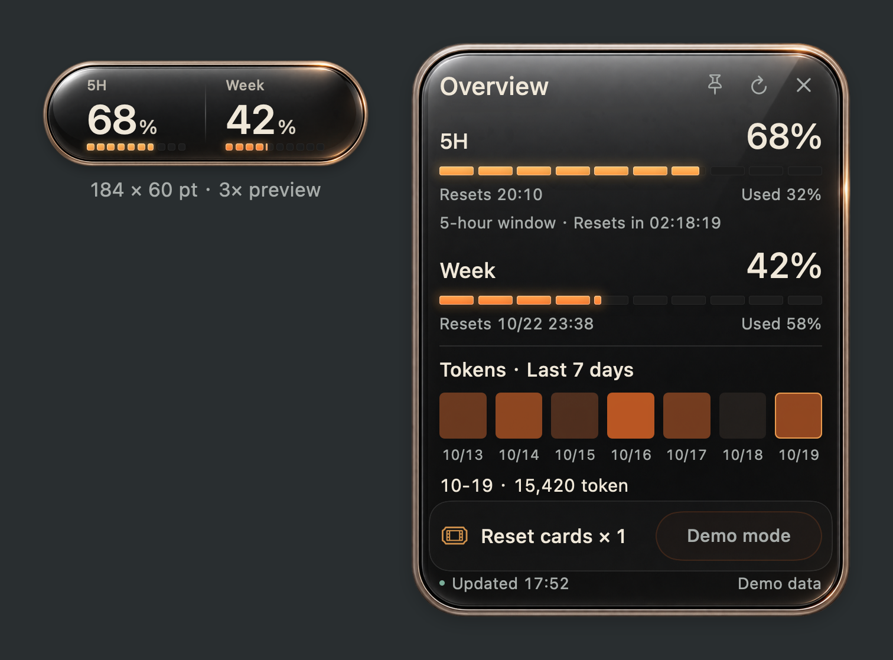

# Usage Capsule

[简体中文](README.zh-CN.md) · **English** · [日本語](README.ja.md) · [한국어](README.ko.md)

A tiny native macOS widget for Codex quota, membership, daily Token use and user-controlled task recovery. Polished dark glass, a warm metal rim, and five clear color levels—at a visible size of **184 × 60 pt**.



## Features in 0.10.1 preview

### Quota, membership and daily usage

- Remaining five-hour and weekly quota, used percentages, reset times and countdowns, mapped by the actual window duration rather than API field order.
- Current membership in the overview: Free, Go, Plus, Pro, Business, Enterprise or Edu when the account reports it. There is no manual plan switch.
- Pro-family five-hour **∞** display when no finite five-hour cap is returned; weekly quota stays metered. Infinity applies only to the five-hour window. Explicit finite quota data takes precedence. [Official plan limits](https://learn.chatgpt.com/docs/pricing).
- Basic Free/Go compatibility when the installed Codex/account exposes usable data. Missing, unsupported and zero usage stay distinct; access is subject to the account's actual capabilities.
- Seven daily Token cells: hover or select a date for its reported daily total. The cells represent consumption, not a promise of a fixed token allowance.
- Membership and usage are checked every **60 seconds**, with manual, supported account-event, app-activation and Mac-wake refresh. This is polling, not instant subscription monitoring; backend updates may take longer.

### A small native desktop surface

- Polished dark glass and a warm metal rim at **184 × 60 pt**, with 100–150% scaling and always-on-top mode.
- Five quota colors: pale gold → amber → orange → vermilion → coral. The illuminated area and color change with quantity; middle levels stay bright and readable.
- Animated hover overview, click to pin, × or Escape to dismiss, and support for reduced system motion.
- Drag from the whole widget frame, preserve its position, and use the menu-bar/right-click controls to find, refresh, configure, hide or quit it.
- Simplified Chinese, English, Japanese and Korean; follow the system language or choose one in Settings.

### User-controlled task recovery

- Select individual Codex conversations; **no task is selected by default**. Choose **Resume once** (default) or **Continuous (unlimited recoveries)** per task. Continuous consent stays active for future quota interruptions until revoked. Selection never immediately starts work or replays pre-selection failures.
- Continuous mode never loops after ordinary completion, owner input, manual stops or unrelated errors. Each distinct quota failure is handed off at most once. Legacy and spent authorizations no longer appear actively checked.
- Three management tabs for authorized tasks, task selection and history. Search loaded tasks/project folders, load more conversations, inspect full available titles and reorder priority.
- After recovery, hand one continuation to the original Codex queue. Subsequent automatic handoffs wait for the exact round and final reply to be confirmed ended, or for explicit owner inspection and release.
- Global pause, per-task revocation, queued-message cancellation and separate five-hour/weekly reserves. Reserves stop new dispatch; they are not hard spending caps on running work.
- Local result cards and optional system notifications for a round ending or failing. Result excerpts are extracted locally without a separate summary-model call. A round ending does not mean the entire project is finished.
- Shared, locked mode-aware authorization records, account binding, durable handoff history and uncertain-delivery reconciliation prevent blind retries. Started work is stopped in its original Codex conversation; the widget never approves tools or automatically uses reset cards.

### Reset cards and connection recovery

- Display eligible reset cards. Hold for 0.8 seconds to open a separate confirmation; only explicit customer confirmation submits a redemption. Account/card state is checked again before submission, and unresolved attempts are reconciled rather than blindly repeated.
- Reconnect once when the local Codex login expires. Persistent authentication failure clears stale quota/membership; temporary failures mark last-known data rather than presenting it as current.
- Account updates invalidate in-flight allowance decisions. Automatic continuation requires affirmative backend usage permission and known usable applicable windows; unknown status stays pending.

**Preview boundaries:** run the widget while the Mac is awake. Native queue, daily usage and card APIs depend on the installed Codex version/account. Pro/Free/Go adaptation has simulated coverage; live Plus reads and real queue/history paths were checked. Free/Go weekly-only missed-reset inference remains conservative. No background daemon runs while the app is closed. See [runtime rules](docs/AUTO_RESUME.md) and [validation scope](docs/VALIDATION.md).

## Requirements

**macOS 13 or later on Apple Silicon**, Xcode Command Line Tools, and a local signed-in Codex CLI for live usage. The native app is written in SwiftUI and AppKit, with no Electron or Node dependency.

This is a community project, not an official OpenAI product. Daily usage and reset-card support depend on the methods exposed by the installed Codex CLI and the current account. Unsupported or missing values appear as unavailable.

## Install with a Codex Skill

Ask Codex:

> Use $skill-installer to install skills/usage-capsule from https://github.com/guihaoyegui-ctrl/usage-capsule. Then use $usage-capsule to build, install, and start the desktop widget on my Mac.

The skill includes the full app source and glass assets. Installing the skill alone does not start a widget. A local macOS session is required; a cloud-only session cannot put a native window on your desktop.

## Build and install manually

Download this repository, open its folder in Terminal, then run:

```sh
zsh skills/usage-capsule/scripts/capsule.sh doctor
zsh skills/usage-capsule/scripts/capsule.sh install
zsh skills/usage-capsule/scripts/capsule.sh start
```

The app is built locally, ad-hoc signed, and installed at `~/Applications/Usage Capsule.app`. This preview is not Developer ID notarized. Do not disable Gatekeeper; build from the reviewed source. If the compiler is missing, install Apple's Command Line Tools with `xcode-select --install`.

Right-click the capsule or use its menu-bar icon for Settings, Refresh, Hide, and Quit. Choose a language in Settings or run:

```sh
zsh skills/usage-capsule/scripts/capsule.sh language en
```

Supported codes: `system`, `zh-Hans`, `en`, `ja`, `ko`. For an offline PNG with sample data, run `preview`. For an installed demo window, run `demo` while the installed app is stopped. `status` checks only this helper's installed process; it does not prove the account is connected.

## Data and privacy

Membership and usage refresh every 60 seconds through local Codex account-reading methods, with event/manual/wake refresh. Quota checks create no model generation turn. Opt-in auto-resume starts a new turn and consumes quota. The app uses your existing local Codex login and has no analytics service or developer backend. See [data flow and privacy](docs/PRIVACY.md) and [troubleshooting](docs/TROUBLESHOOTING.md).

## Development

```sh
zsh skills/usage-capsule/assets/app/test.sh
zsh skills/usage-capsule/assets/app/test.sh --ui
```

The first command checks quota math, reset idempotency, interaction state, and all four translation packs. `--ui` also checks native hit coverage and requires a desktop session. Tests never redeem a reset card. See [validation scope](docs/VALIDATION.md) and [release notes](CHANGELOG.md).

Source lives inside [`skills/usage-capsule/assets/app`](skills/usage-capsule/assets/app), so the skill remains self-contained when installed separately. The root `plugin.json` also packages the skill in the portable Agent Plugins layout; publishing this repository does not list it in the official plugin directory.

## License

No open-source license has been selected for this preview yet.
