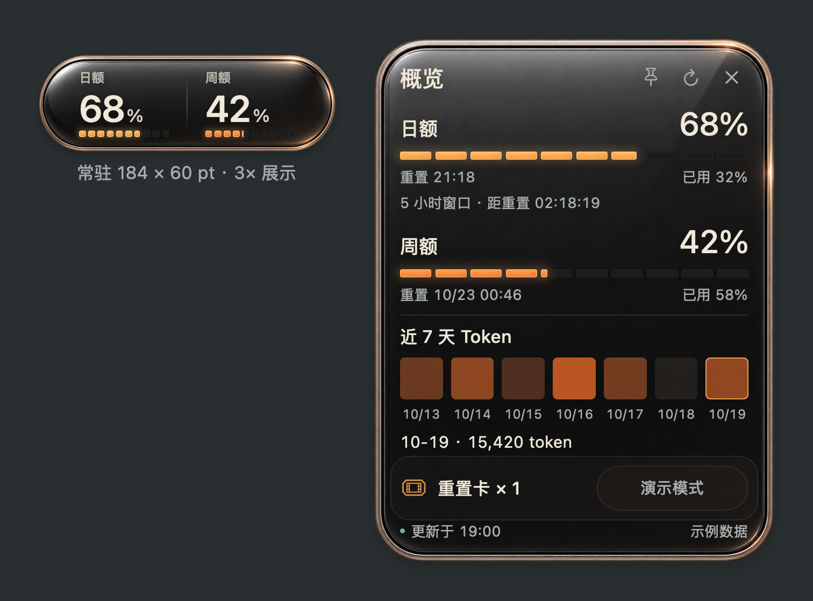

# 用量胶囊 · Usage Capsule

**简体中文** · [English](README.md) · [日本語](README.ja.md) · [한국어](README.ko.md)

一个小巧的原生 macOS 桌面胶囊，查看 Codex 额度、会员等级、每日 Token 消耗，并按授权续跑任务。深色光泽玻璃、暖金属边缘、五档清晰颜色，常驻可见尺寸 **184 × 60 pt**。



## 0.10.0 预览版功能

### 额度、会员与每日消耗

- 查看日额（五小时窗口）、周额、已用比例、重置时间和倒计时；按真实窗口时长归位，避免把周额度误放进日额栏。
- 概览显示接口返回的会员等级：Free、Go、Plus、Pro、Business、Enterprise 或 Edu，无需手动选择套餐。
- Pro 家族未返回有限五小时窗口时，日额显示 **∞**，隐藏该栏倒计时和保留值；周额度仍显示真实百分比。∞ 仅代表五小时不限额，实际返回的有限窗口优先。[官方额度说明](https://learn.chatgpt.com/docs/pricing)。
- Free／Go 在本机 Codex 和账号提供数据时基础兼容；不支持、未知和零消耗分别处理，不虚构额度或解锁账号本来没有的能力。
- 近七天 Token 小格子：悬停或点击日期查看接口报告的当天消耗。消耗统计不等于固定 Token 配额。
- 会员与用量默认每 **60 秒**检查；手动刷新、收到支持的账号更新事件、胶囊重新激活和电脑唤醒时补查。不是瞬时实时监控，服务端订阅状态也可能延迟更新。

### 原生迷你胶囊

- 深色光泽玻璃与暖金属边缘，常驻可见尺寸 **184 × 60 pt**，支持 100–150% 缩放和置顶。
- 浅金、琥珀、橙、朱橙、珊瑚红五档颜色；亮灯面积与颜色随余量变化，中等额度保持清晰明亮。
- 悬停动画呼出概览，点击固定，× 或 Escape 关闭；兼容系统减少动态效果设置。
- 全窗口范围拖动、记住位置；右键或菜单栏可找回、刷新、设置、隐藏和退出。
- 简体中文、英语、日语、韩语，支持跟随系统及手动切换。

### 可控自动续跑

- 只处理用户明确选择的 Codex 对话，**默认不选任何任务**。每项可选 **仅续跑一次**（默认）或 **持续续跑（不限次数）**。持续授权在之后每次额度中断恢复后接续，直到用户取消；不立即启动，也不追溯授权前的旧失败。
- 持续模式不会在正常回复结束、等待你处理、手动停止或其他错误后自动开新一轮。每个额度中断最多交接一次；旧选择和已用完的授权不再误显示为有效勾选。
- “已授权任务／选择任务／续跑记录”三个页签；搜索已加载任务或项目、加载更多、查看完整可用标题、调整优先级。
- 额度恢复后把一条继续指令交给原对话的 Codex 队列；确认对应回合和最终回复已结束后，再自动放行下一项。无法确认时等待用户核实。
- 总暂停、单项取消授权、撤回尚未执行的排队指令；日额与周额可分别保留余量。保留值阻止新增派发，不是正在运行任务的硬消耗上限。
- 本地结果卡、原对话直达入口，以及用户自愿开启的本轮结束／失败通知。摘录直接取自原回复，不额外调用模型做摘要；本轮结束不等于整个项目完成。
- 跨实例共享的模式授权、撤销记录、账号绑定和持久化交接保护；提交结果不确定时不盲目重发。已开始的任务在原对话停止，权限审批仍由 Codex 和用户处理。

### 重置确认与登录恢复

- 查询可用重置卡，长按 0.8 秒先打开确认框；客户明确确认后才提交，并再次检查账号和卡片状态。未确认的兑换会核实原请求，不盲目重复消费。
- 自动续跑不会使用重置卡；演示模式不能兑换。
- 登录过期自动重建连接并重试一次；仍失败则清除旧额度与会员信息。临时读取失败标记上次确认，避免把旧数据当成当前数据。
- 收到账号更新事件立即使旧的派发判断失效；后台必须明确允许继续，且适用额度可确认后，才会自动续跑。

**预览边界：**胶囊需运行、电脑需唤醒；原生队列、日消耗和卡片接口取决于 Codex 版本及账号。Pro／Free／Go 适配已做模拟验证，真实 Plus 读取、队列及历史关联已检查；Free／Go 仅有周窗口时的遗漏重置推断暂保守处理。退出后没有后台守护进程继续监控。详见[运行规则](docs/AUTO_RESUME.md)和[验证范围](docs/VALIDATION.md)。

## 使用条件

需要 **Apple Silicon Mac、macOS 13 或更高版本、Xcode 命令行工具**。查询真实用量还需要本机已登录的 Codex CLI。应用使用 SwiftUI 与 AppKit，无需 Electron 或 Node。

这是社区作品，并非 OpenAI 官方产品。每日消耗和重置卡功能取决于本机 Codex CLI 与账号支持；没有返回的数据会显示为不可用。

## 通过 Skill 安装

把下面这段话发给 Codex：

> 使用 $skill-installer 从 https://github.com/guihaoyegui-ctrl/usage-capsule 安装 skills/usage-capsule，然后使用 $usage-capsule 在我的 Mac 上构建、安装并启动用量胶囊。

Skill 自带完整应用源码和玻璃素材。安装 Skill 后还需构建并启动应用；只有云端的会话无法在你的桌面显示原生窗口。

## 手动安装

下载仓库，在终端进入仓库文件夹后依次执行：

```sh
zsh skills/usage-capsule/scripts/capsule.sh doctor
zsh skills/usage-capsule/scripts/capsule.sh install
zsh skills/usage-capsule/scripts/capsule.sh start
```

安装位置为 `~/Applications/Usage Capsule.app`。应用在本机编译并临时签名，当前预览版尚未经过 Developer ID 公证。请审阅源码后本机构建，保持 Gatekeeper 启用。缺少编译工具时，使用 `xcode-select --install` 安装 Apple 命令行工具。

右键胶囊或点击菜单栏图标，即可设置语言、刷新、隐藏和退出。也可用 `language zh-Hans` 切换语言；支持 `system`、`zh-Hans`、`en`、`ja`、`ko`。

`preview` 输出离线示例 PNG；`demo` 在已安装的胶囊停止运行时打开演示窗口。`status` 仅检查安装的进程，账号是否连通请以概览内同步结果为准。

## 刷新与隐私

每 60 秒通过本机 Codex app-server 查询会员与用量，并支持事件、手动和唤醒补查，不创建模型生成任务，因此刷新本身不会调用模型生成 Token。启用自动续跑后，实际继续任务会消耗额度；安装和交谈过程也有正常的模型用量。应用复用本机 Codex 登录，无需 API Key，没有开发者服务器或统计上报。详见[数据与隐私](docs/PRIVACY.md)、[常见问题](docs/TROUBLESHOOTING.md)。

## 验证与源码

```sh
zsh skills/usage-capsule/assets/app/test.sh
zsh skills/usage-capsule/assets/app/test.sh --ui
```

包含额度计算、重置幂等保护、交互状态及四种翻译的检查；`--ui` 增加原生点击范围验证，需要桌面环境。测试不会消费重置卡。详见[验证范围](docs/VALIDATION.md)及[版本记录](CHANGELOG.md)。

源码位于 [`skills/usage-capsule/assets/app`](skills/usage-capsule/assets/app)。公开 GitHub 仓库与上架官方插件目录是不同步骤，当前发布为 GitHub 项目与可安装 Skill。

当前预览版尚未选择开源许可证。
